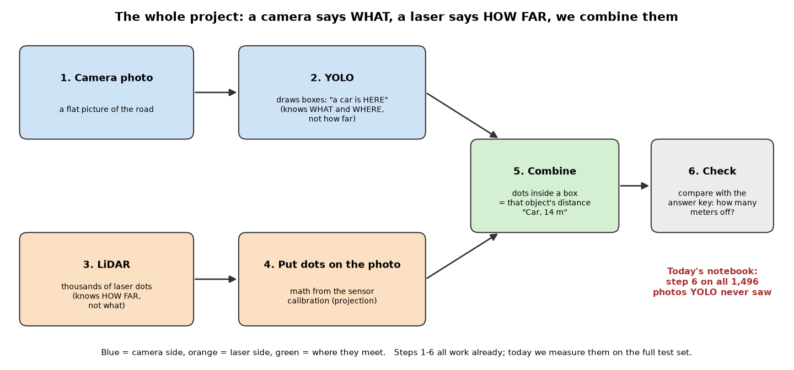
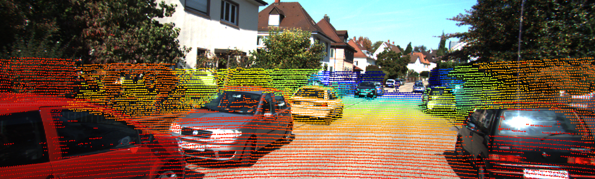
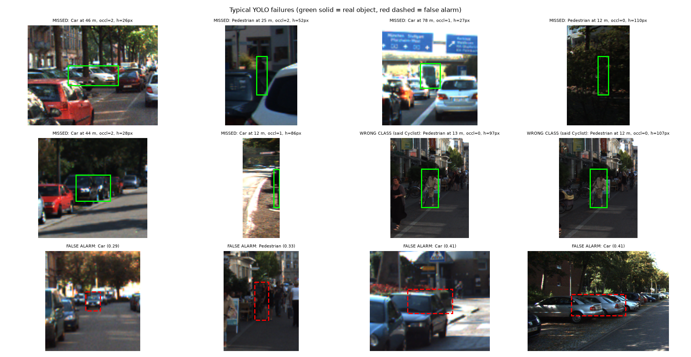
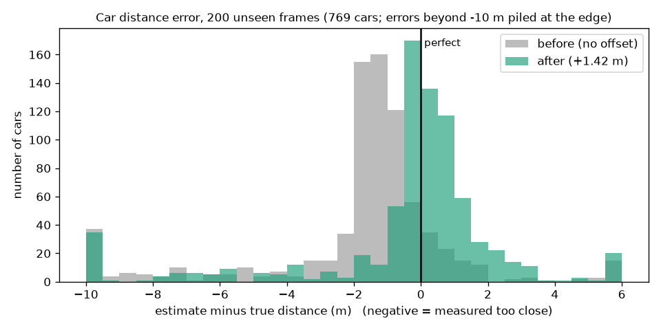
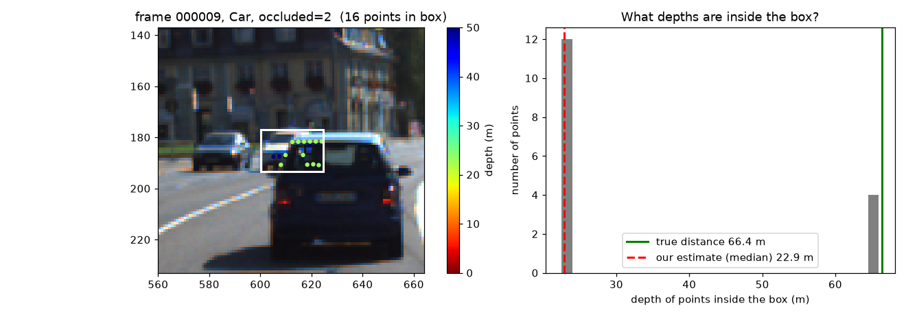
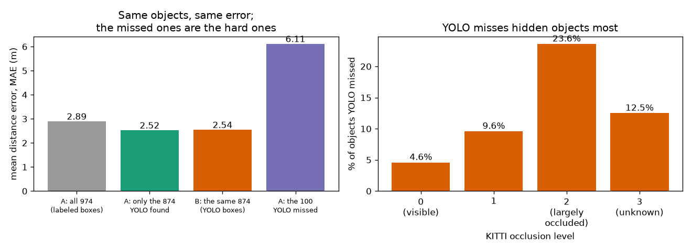

# Camera × LiDAR Object Detection with Distance Estimation (KITTI)

YOLO finds **what** an object is and **where** it is in the camera image. The LiDAR points that fall inside each box tell **how far away** it is.



## Results at a glance

All numbers come from the full validation split (1,496 frames, 7,582 objects). The split is 80/20 by frame, seed 42, because KITTI has no official val split.

| | Result |
|---|---|
| Detection (YOLO11n, 50 epochs) | mAP50 **0.850**, mAP50-95 **0.577** |
| Car distance, median abs. error | **1.40 m → 0.69 m** after the bias correction |
| All classes, median abs. error | 1.34 m → 0.67 m |
| GT objects missed by the detector | 10.3% (Pedestrian 28.6%, the weakest class) |



## How it works

```
camera image ──► YOLO11n (2D detection) ──► boxes: [class, x1, y1, x2, y2, conf]
                                                         │
LiDAR point cloud ──► project to image pixels ──► points inside each box
  (KITTI calibration: Tr_velo_to_cam, R0_rect, P2)       │
                                                         ▼
                                  distance = median depth of those points
                                                         │
                                                         ▼
                           evaluate against KITTI ground-truth z (meters)
```

1. **Detection:** KITTI labels are converted to YOLO format with 3 classes: Car (+Van), Pedestrian (+Person_sitting) and Cyclist. Ultralytics YOLO11n was trained on a Kaggle T4 (imgsz 640, 50 epochs, 1.25 h).
2. **Projection:** each LiDAR point goes from LiDAR coordinates to camera coordinates (`Tr_velo_to_cam`), gets the rectification rotation (`R0_rect`), and is projected to pixels with the camera matrix (`P2`). Only points in front of the camera and inside the image are kept.
3. **Distance:** the median depth of the projected points inside a box. If there are fewer than 5 points, the box gets no estimate.
4. **Evaluation** uses two settings, so that detection errors and fusion errors can be separated:

| Setting | Boxes | What it measures |
|---|---|---|
| A. Oracle | Ground-truth 2D boxes | Error of the fusion method alone |
| B. End-to-end | YOLO boxes matched to GT (IoU ≥ 0.5, same class) | Error of the full system; unmatched GT objects count as "missed" |

## Detection

| class | instances | precision | recall | mAP50 | mAP50-95 |
|:--|--:|--:|--:|--:|--:|
| all | 7582 | 0.866 | 0.767 | 0.850 | 0.577 |
| Car | 6385 | 0.920 | 0.906 | 0.958 | 0.764 |
| Pedestrian | 884 | 0.849 | 0.643 | 0.771 | 0.434 |
| Cyclist | 313 | 0.828 | 0.752 | 0.819 | 0.533 |

Failure analysis on 200 val frames ([details](results/metrics/detection_analysis.md)):

- **Occlusion hurts most.** Recall is 95.4% for fully visible objects but 76.4% for largely occluded ones (KITTI occlusion level 2).
- **Pedestrians are the weak class.** Typical misses are people in deep shadow or half hidden behind a car.
- **Distance matters a lot for small objects.** On the full val split, the pedestrian miss rate grows from 18% (0–20 m) to 50% (20–40 m) and 65% (40 m+).



## Distance estimation

### Finding: cars are measured too short

LiDAR hits the **near surface** of a car, but KITTI's label `z` is the **center** of the 3D box. So the estimates should come out short, and they do: the median signed error for cars is −1.33 m in Setting A.

The bias is smaller than half a car length (about 1.96 m). A likely reason is that some points land on the side or roof of the car, which pulls the median deeper. This has not been tested.

### Improvement: a constant bias correction for cars

A constant offset of **+1.42 m** was added to every Car estimate. It was fitted on a separate 50-frame dev sample, not on the val split. I also tried a physics-based offset (+1.96 m, half the mean car length); it overshoots, so the data-fitted value is the one used.

Car, Setting B, full val split:

| range | median abs. error before | after | MAE before | after |
|:--|--:|--:|--:|--:|
| 0–20 m | 0.93 m | 0.89 m | 1.52 m | 1.64 m |
| 20–40 m | 1.52 m | 0.59 m | 2.63 m | 1.81 m |
| 40 m+ | 1.74 m | 0.53 m | 3.98 m | 2.97 m |
| **All** | **1.40 m** | **0.69 m** | **2.50 m** | **1.99 m** |



- The correction roughly halves the typical error and helps most from 20 m outwards.
- At 0–20 m it slightly overshoots (median signed error −0.64 m → +0.78 m) because the bias grows with distance. A distance-dependent offset is the obvious next step.
- Note: this corrects towards KITTI's box-center convention. For driving, the distance to the nearest surface may be the more useful quantity.

### Finding: occlusion causes the large errors

The mean error is much larger than the median error, so a few very wrong estimates dominate. I looked at the 3 worst cases: in each one, the target car is partly hidden, and the box also contains LiDAR points from a **nearer object in front of it**. The median then lands on the nearer object. For example, frame 000009 has a true distance of 66.4 m and an estimate of 22.9 m.



A depth-only rule such as "nearest cluster" or "largest cluster" does not fix all three cases. A candidate fix is to ignore points that fall inside another, nearer detection's box (not implemented yet).

### Setting A vs. Setting B

Setting B's errors look lower than Setting A's (MAE 2.34 m vs 2.81 m), but that is survivorship bias: B leaves out the ~10% hardest objects that YOLO missed. On the same objects, YOLO boxes and ground-truth boxes give almost the same distance error (MAE 2.54 m vs 2.52 m on 874 matched objects in a 200-frame sample). The end-to-end cost shows up as **missed objects**, not as worse distances.



Full tables: [Setting A](results/metrics/distance_eval_A_oracle_fullval.md), [Setting B baseline](results/metrics/distance_eval_B_fullval_baseline.md), [Setting B + offset](results/metrics/distance_eval_B_fullval_offset142.md). Every experiment is recorded in [results/log.md](results/log.md).

## Limitations and next steps

- Cyclists are biased **long** (median +1.26 m in Setting B). The untested hypothesis: a cyclist's box is thin, so it contains many background points behind them.
- The car offset was fitted on 158 cars from one dev sample and tested in a single run.
- False positives are not included in the distance tables. Some of them look like real but unlabeled objects (checked on 4 examples only).
- Next steps: a distance-dependent offset, removing points from nearer occluding boxes, and a confidence-threshold study for pedestrians.

## Repository structure

```
configs/kitti.yaml          YOLO dataset config
src/                        kitti_io, projection, fusion, matching, yolo_format
scripts/                    split, convert, visualize, evaluate, analyze
notebooks/                  thin Kaggle wrappers (training on GPU, evaluation)
results/log.md              experiment log
results/metrics/            evaluation tables (Markdown + CSV)
results/figures/            figures used in this README
```

## Reproduce

Data: [KITTI 3D Object Detection](https://www.cvlibs.net/datasets/kitti/eval_object.php?obj_benchmark=3d) training split (`image_2`, `label_2`, `calib`, `velodyne`). Training ran on Kaggle; the scripts also run locally on a small sample.

```bash
pip install -r requirements.txt

# 1. Split and convert to YOLO format
python scripts/make_split.py --kitti_root <KITTI>/training
python scripts/convert_kitti_to_yolo.py --kitti_root <KITTI>/training --out data/kitti_yolo

# 2. Train (see notebooks/kaggle_train.ipynb)
yolo detect train data=configs/kitti.yaml model=yolo11n.pt imgsz=640 epochs=50 batch=32 seed=42

# 3. Visualize the LiDAR projection
python scripts/visualize_projection.py --kitti_root <KITTI>/training --frames 000008

# 4. Distance evaluation
python scripts/eval_distance.py --kitti_root <KITTI>/training --split_file data/splits/val.txt            # Setting A
python scripts/eval_distance.py --kitti_root <KITTI>/training --split_file data/splits/val.txt \
    --weights best.pt --car_offset 1.42                                                                 # Setting B + offset
```

## Notes

- Built as a learning and portfolio project, using Claude Code as a coding assistant. All metrics come from actual runs recorded in `results/log.md`.
- Licenses: KITTI is CC BY-NC-SA 3.0 and Ultralytics is AGPL-3.0, so this project is non-commercial.

Author: Sean Pan (Tokyo Denki University, Information Systems Design)
